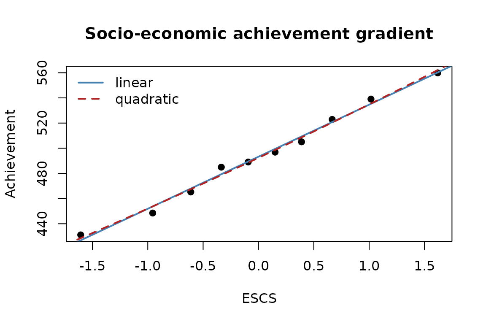

# Getting started with lsastrat

``` r

library(lsastrat)
data(pisa_mini)
```

## What lsastrat does

`lsastrat` turns large-scale assessment (LSA) data (PISA, TIMSS, PIRLS,
PIAAC) into the stratification and inequality quantities that education
researchers report, and returns them as first-class objects. It handles
the two features that make LSA data awkward:

- **Plausible values (PVs).** Achievement is reported as several imputed
  draws, not a single score. Every estimator is computed on each PV and
  the results are combined with Rubin’s (1987) rules, so the measurement
  uncertainty enters the standard error.
- **Replicate weights.** Complex sampling means the variance must be
  estimated from replicate weights (BRR/Fay for PISA; JK2 for
  TIMSS/PIRLS) or, for the segregation indices, a clustered bootstrap.

Inference uses a *t* reference with Rubin degrees of freedom (not the
normal), which matters because LSA studies provide only 5 or 10
plausible values.

## What this replaces

Consider the standard workflow for one of the most-reported quantities
in educational stratification, the ESCS gradient for a set of countries.
Done by hand it means: for each country, fit 10 plausible values x 81
weights = 810 weighted regressions, pool the slopes with Rubin’s rules,
derive the strength from the pooled R-squared, and keep track of the Fay
factor – then repeat for every country, and again for every robustness
variant. General LSA packages (`intsvy`, `EdSurvey`, `Rrepest`) automate
the *regression* but still leave the gradient, segregation indices,
opportunity decompositions and their correct inference to be assembled
manually, and none applies the finite-sample bias correction the
segregation literature calls for. In `lsastrat` each of these is one
call returning a labelled estimate with design-correct uncertainty:

``` r

lsa_by(stu, by = "CNT", estimator = social_gradient,
       achievement = paste0("PV", 1:10, "MATH"), escs = "ESCS", design = des)
```

and
[`tidy()`](https://kevinschoenholzer.com/lsastrat/reference/tidy.lsastrat_estimate.md)
turns any result into a publication table, `autoplot()` into a figure,
and
[`lsa_multiverse()`](https://kevinschoenholzer.com/lsastrat/reference/lsa_multiverse.md)
into a robustness analysis.

All examples use `pisa_mini`, a **fully simulated** PISA-like data set
bundled with the package (it is *not* real PISA data). It has 10
plausible values each for mathematics and reading
(`PV1MATH`…`PV10MATH`), a final weight (`W_FSTUWT`), 64 Fay BRR
replicate weights (`W_FSTURWT1`…`W_FSTURWT64`), and background
variables.

``` r

reps <- paste0("W_FSTURWT", 1:64)
math <- paste0("PV", 1:10, "MATH")
```

## The socio-economic gradient

[`social_gradient()`](https://kevinschoenholzer.com/lsastrat/reference/social_gradient.md)
follows the OECD definition: the **slope** is the score-point change per
one unit of the socio-economic index (ESCS), the **strength** is the
percentage of achievement variance it explains (R² × 100), and
**curvature** is an optional quadratic term.

``` r

g <- social_gradient(pisa_mini, achievement = math, escs = "ESCS",
                     weight = "W_FSTUWT", repweights = reps)
g
#> Socio-economic achievement gradient
#>   SES index: ESCS   |   10 plausible value(s)   |   n = 2048
#>   Variance:  BRR, 64 replicate weights (+ PV imputation); t reference
#> 
#> 
#>           Estimate Std.Error     t    df       p
#> slope       41.357     1.831 22.59 399.4 2.1e-73
#> strength    20.189     1.799 11.22 389.1 1.7e-25
#> curvature    1.025     1.597  0.64 406.7 5.2e-01
#> 
#> slope = score points per 1 unit of ESCS; strength = % variance explained (R^2 x 100)
```

The result behaves like a model object:

``` r

coef(g)
#>     slope  strength curvature 
#> 41.357302 20.188700  1.025083
confint(g)
#>               2.5 %    97.5 %
#> slope     37.758539 44.956065
#> strength  16.651036 23.726363
#> curvature -2.113944  4.164111
```

``` r

plot(g)
```



## School segregation

[`segregation_index()`](https://kevinschoenholzer.com/lsastrat/reference/segregation_index.md)
reports the family of indices used in stratification research. Pass a
categorical `group` for **social** segregation:

``` r

segregation_index(pisa_mini, unit = "school_id", group = "IMMIG",
                  weight = "W_FSTUWT", variance = "bootstrap",
                  n_boot = 99, boot_seed = 1)
#> Segregation indices (social segregation)
#>   unit: school_id  |  128 units  |  3 group(s)  |  minority: first_gen
#>   Variance: clustered bootstrap (B=99, cluster=school_id), bias-corrected
#> 
#> 
#>           Estimate Std.Error     t  df       p
#> D            0.578     0.037 15.45 Inf 7.8e-54
#> S            0.554     0.040 13.83 Inf 1.7e-43
#> isolation    0.097     0.027  3.55 Inf 3.8e-04
#> Hutchens     0.362     0.036  9.97 Inf 2.2e-23
#> H            0.095     0.017  5.50 Inf 3.9e-08
#> M            0.074     0.016  4.59 Inf 4.3e-06
```

The entropy and dissimilarity indices are upward-biased when schools are
small, which is exactly the LSA case. With `variance = "bootstrap"` a
two-stage clustered bootstrap estimates and removes that bias
(`debias = TRUE`) and gives a design-correct standard error. With
replicate weights you can instead use them directly (no bias
correction):

``` r

segregation_index(pisa_mini, unit = "school_id", group = "IMMIG",
                  weight = "W_FSTUWT", repweights = reps,
                  indices = c("D", "H", "M"))
#> Segregation indices (social segregation)
#>   unit: school_id  |  128 units  |  3 group(s)  |  minority: first_gen
#>   Variance: BRR, 64 replicate weights; t reference
#> 
#> 
#>   Estimate Std.Error     t  df       p
#> D    0.658     0.040 16.47 Inf 6.2e-61
#> H    0.157     0.012 13.12 Inf 2.5e-39
#> M    0.122     0.011 11.39 Inf 4.8e-30
```

For **academic** segregation, define the group by an achievement
threshold; the index is then pooled across plausible values:

``` r

segregation_index(pisa_mini, unit = "school_id", achievement = math,
                  cutoff = 480, indices = c("D", "H"),
                  variance = "bootstrap", n_boot = 99, boot_seed = 1)
#> No `weight` supplied; using equal weights.
#> Segregation indices (academic segregation)
#>   unit: school_id  |  128 units  |  2 group(s)  |  minority: below
#>   Variance: clustered bootstrap (B=99, cluster=school_id), bias-corrected (+ PV imputation)
#> 
#> 
#>   Estimate Std.Error    t    df       p
#> D    0.218     0.026 8.39 109.0 1.9e-13
#> H    0.052     0.019 2.83 475.3 4.9e-03
```

## Inequality of educational opportunity

[`ieop()`](https://kevinschoenholzer.com/lsastrat/reference/ieop.md)
implements the Ferreira–Gignoux (2014) decomposition: the share of
achievement variance explained by pre-determined **circumstances**.

``` r

ieop(pisa_mini, achievement = math,
     circumstances = c("IMMIG", "parental_edu", "books"),
     weight = "W_FSTUWT", repweights = reps)
#> Inequality of educational opportunity (Ferreira-Gignoux)
#>   10 plausible value(s)  |  n = 2048  |  3 circumstance(s): IMMIG, parental_edu, books
#>   Variance: BRR, 64 replicate weights (+ PV imputation); t reference
#> 
#> 
#>               Estimate Std.Error     t     df        p
#> iop              0.209     0.018 11.79  612.6  4.6e-29
#> iop_adj          0.206     0.018 11.58  610.7  3.7e-28
#> explained_var 1518.225   143.167 10.60 1204.1  3.5e-25
#> total_var     7253.731   228.176 31.79  517.7 8.7e-124
#> 
#> iop = share of achievement variance explained by circumstances (raw R^2, upper bound); iop_adj = df-adjusted
```

The raw `iop` is the regression R² and is an **upper bound**: it
inflates as the circumstance set grows. `iop_adj` is the
degrees-of-freedom adjusted version; prefer it, and treat `iop` as the
ceiling. `explained_var` is the absolute inequality of opportunity
(variance of predicted scores) and `total_var` the total achievement
variance.

## Comparing groups

[`lsa_by()`](https://kevinschoenholzer.com/lsastrat/reference/lsa_by.md)
runs any estimator across the levels of a grouping variable and stacks
the results into one comparable table – the workhorse for cross-country
work.
[`equity_scatter()`](https://kevinschoenholzer.com/lsastrat/reference/equity_scatter.md)
draws the OECD quality-vs-equity scatter.

``` r

by_imm <- lsa_by(pisa_mini, by = "IMMIG", estimator = social_gradient,
                 achievement = math, escs = "ESCS", weight = "W_FSTUWT",
                 repweights = reps)
by_imm
#> `social_gradient` by IMMIG  (3 groups)
#> 
#>       group      term estimate     se statistic       df     p   ci_lo  ci_hi
#>      native     slope   41.867  2.070    20.224  580.355 0.000  37.801 45.933
#>      native  strength   20.192  1.934    10.438  346.181 0.000  16.388 23.997
#>      native curvature    0.752  1.920     0.392  242.884 0.696  -3.031  4.534
#>  second_gen     slope   39.234  3.548    11.058  792.323 0.000  32.269 46.198
#>  second_gen  strength   17.931  2.935     6.108  425.972 0.000  12.161 23.700
#>  second_gen curvature    0.560  2.792     0.201 1125.479 0.841  -4.919  6.039
#>   first_gen     slope   32.697 11.252     2.906  338.768 0.004  10.566 54.829
#>   first_gen  strength   13.126  9.079     1.446  258.647 0.149  -4.752 31.003
#>   first_gen curvature    7.279  8.914     0.817  600.676 0.414 -10.227 24.785
```

## Decomposing inequality

Three decompositions break a quantity into interpretable parts. The
between-school variance share (a strongly stratified system has a high
value):

``` r

variance_decomposition(pisa_mini, math, unit = "school_id",
                       weight = "W_FSTUWT", repweights = reps)
#> Between/within-unit variance decomposition
#>   unit: school_id  |  128 units  |  10 plausible value(s)  |  n = 2048
#>   Variance: BRR, 64 replicate weights (+ PV imputation); t reference
#> 
#> 
#>             Estimate Std.Error     t     df        p
#> icc            0.153     0.017  9.15 1259.2  2.3e-19
#> var_between 1110.411   133.168  8.34 1561.8  1.6e-16
#> var_within  6143.320   205.537 29.89  384.4 2.7e-102
#> var_total   7253.731   228.176 31.79  517.7 8.7e-124
#> 
#> icc = between-unit share of achievement variance
```

The Shapley decomposition attributes the inequality of opportunity to
each circumstance (the contributions sum to the total relative IOp):

``` r

ieop_decompose(pisa_mini, math,
               circumstances = c("IMMIG", "parental_edu", "books"),
               weight = "W_FSTUWT", repweights = reps)
#> Inequality of opportunity: Shapley decomposition
#>   10 plausible value(s)  |  n = 2048  |  3 circumstance(s)
#>   Variance: BRR, 64 replicate weights (+ PV imputation); t reference
#> 
#> 
#>              Estimate Std.Error    t    df       p
#> IMMIG           0.009     0.005 2.01 425.3 4.5e-02
#> parental_edu    0.106     0.013 7.86 263.8 9.8e-14
#> books           0.094     0.013 7.44 178.5 4.1e-12
#> 
#> Shapley contributions to relative IOp (R^2); they sum to the total
```

The Oaxaca-Blinder decomposition splits an achievement gap into an
explained (composition) and an unexplained (structure) part:

``` r

d2 <- pisa_mini[pisa_mini$IMMIG %in% c("native", "first_gen"), ]
d2$IMMIG <- factor(d2$IMMIG)
oaxaca_gap(d2, math, group = "IMMIG",
           predictors = c("ESCS", "books", "parental_edu"),
           weight = "W_FSTUWT", repweights = reps)
#> Oaxaca-Blinder gap decomposition (twofold)
#>   IMMIG: native - first_gen  |  10 plausible value(s)  |  n = 1421
#>   Variance: BRR, 64 replicate weights (+ PV imputation); t reference
#> 
#> 
#>             Estimate Std.Error    t       df       p
#> gap           32.004     9.690 3.30    627.4 1.0e-03
#> explained     29.250     5.364 5.45 134118.7 5.0e-08
#> unexplained    2.755     8.819 0.31    476.5 7.5e-01
#> 
#> gap = mean(native) - mean(first_gen); components sum to gap
```

## Multiverse analysis

[`lsa_multiverse()`](https://kevinschoenholzer.com/lsastrat/reference/lsa_multiverse.md)
runs an estimator across a grid of analytic forking paths so you can
read off how robust a finding is. Bundle the design once with
[`lsa_design()`](https://kevinschoenholzer.com/lsastrat/reference/lsa_design.md):

``` r

des <- lsa_design(weight = "W_FSTUWT", repweights = reps)
mv <- lsa_multiverse(
  pisa_mini, estimator = social_gradient,
  grid = list(
    achievement = list(math = math, read = paste0("PV", 1:10, "READ")),
    curvature = list(linear = FALSE, quadratic = TRUE)
  ),
  fixed = list(escs = "ESCS"), design = des, term = "slope")
mv
#> Multiverse: `social_gradient`, term = slope  (4 specifications)
#>   median estimate: 39.1   range: [36.8, 41.4]
#>   100% of specifications share the sign of the median; 100% exclude 0 (95% CI)
```

Every result has a
[`plot()`](https://rdrr.io/r/graphics/plot.default.html) method, and an
`autoplot()` method when ggplot2 is installed
(e.g. `autoplot(by_imm, term = "slope")` for a forest plot, or
`autoplot(mv)` for the specification curve).

## Beyond the built-in estimators

[`lsa_model()`](https://kevinschoenholzer.com/lsastrat/reference/lsa_model.md)
fits *any* model to a plausible-value outcome with replicate-weight
inference – a multiple regression, a logistic model, or a multilevel
model – pooling over plausible values exactly as the built-in estimators
do. Supply a one-sided formula; the outcome is filled in from each
plausible value.

``` r

lsa_model(pisa_mini, ~ ESCS + IMMIG + female, achievement = math, design = des)
#> Model: stats::lm(<PV> ~ ESCS + IMMIG + female)
#>   10 plausible value(s)  |  n = 2048
#>   Variance: BRR, 64 replicate weights (+ PV imputation); t reference
#> 
#> 
#>                 Estimate Std.Error      t    df       p
#> (Intercept)      500.857     2.876 174.15 906.1 0.0e+00
#> ESCS              40.659     1.867  21.78 379.4 8.2e-69
#> IMMIGsecond_gen   -9.437     4.284  -2.20 223.0 2.9e-02
#> IMMIGfirst_gen    -3.537     9.344  -0.38 470.4 7.1e-01
#> female            -9.770     4.599  -2.12 279.3 3.5e-02
#> 
#> fitter = stats::lm
```

[`lsa_trend()`](https://kevinschoenholzer.com/lsastrat/reference/lsa_trend.md)
compares a quantity across assessment cycles and folds the linking
(equating) error into the standard error of the change:

``` r

half <- nrow(pisa_mini) %/% 2
c1 <- social_gradient(pisa_mini[1:half, ], math, "ESCS", design = des)
c2 <- social_gradient(pisa_mini[-(1:half), ], math, "ESCS", design = des)
lsa_trend(list("2018" = c1, "2022" = c2), term = "slope", link_error = 3.5)
#> Trend in `slope` (social_gradient) across 2 cycles; baseline = 2018
#>   linking error: 3.5 (added to each change SE)
#> 
#>  cycle estimate    se change change.se    z    p
#>   2018   41.308 2.874  0.000        NA   NA   NA
#>   2022   41.454 2.426  0.146     5.137 0.03 0.98
#> 
#> change = estimate - baseline; SE includes the linking error
```

On large data the replicate-weight refits can be run in parallel with
`options(lsastrat.cores = 4)` (Unix/macOS).

## TIMSS, PIRLS and PIAAC

The estimators do not depend on PISA. They need plausible values, a
final weight and replicate weights, and the name of the replication
method.

TIMSS and PIRLS ship no replicate weights. They ship the final weight
(`TOTWGT`), a jackknife zone (`JKZONE`) and a replicate indicator
(`JKREP`).
[`jk2_weights()`](https://kevinschoenholzer.com/lsastrat/reference/jk2_weights.md)
builds one replicate weight per zone from these columns. The toy sample
below has four zones with two schools each.

``` r

iea <- data.frame(
  JKZONE = rep(1:4, each = 6),
  JKREP  = rep(rep(0:1, each = 3), times = 4),
  TOTWGT = 1,
  score  = c(480, 510, 495, 530, 500, 520, 470, 505, 490, 515, 525, 500,
             540, 495, 510, 485, 500, 530, 505, 515, 490, 520, 480, 510)
)
iea <- jk2_weights(iea)
iea_des <- lsa_design(weight = "TOTWGT", repweights = attr(iea, "repweights"),
                      rep_method = "JK2")
lsa_model(iea, ~ 1, achievement = "score", design = iea_des)
#> Model: stats::lm(<PV> ~ 1)
#>   1 plausible value(s)  |  n = 24
#>   Variance: JK2, 4 replicate weights (+ PV imputation); t reference
#> 
#> 
#>             Estimate Std.Error     t  df p
#> (Intercept)      505      4.32 116.9 Inf 0
#> 
#> fitter = stats::lm
```

PIAAC ships 80 replicate weights (`SPFWT1` to `SPFWT80`) and names the
replication method of each country in the variable `VEMETHOD`. Pass that
method to
[`lsa_design()`](https://kevinschoenholzer.com/lsastrat/reference/lsa_design.md);
the script `data-raw/validate_piaac.R` in the source repository shows
the full call.

## Where it fits

`lsastrat` complements rather than replaces general LSA packages such as
`EdSurvey`, `intsvy`, `BIFIEsurvey`, `RALSA` and OECD’s `Rrepest`, which
provide the generic estimators but leave these stratification quantities
to be assembled by hand. The estimators are cross-validated against
[`intsvy::pisa.reg.pv()`](https://rdrr.io/pkg/intsvy/man/pisa.reg.pv.html),
the `segregation` package, and a weighted regression R². \`\`\`
